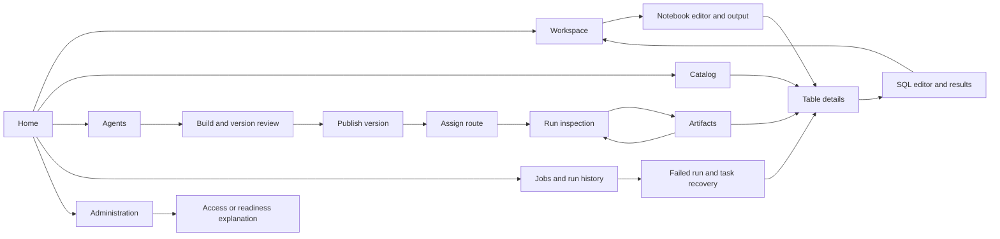

# Workbench redesign: design review

Status: stages 1 and 2 complete; the user approved the connected prototype on 29 October 2026 and authorized production migration and missing-feature delivery. The prototype remains an isolated design reference. Track implementation in [production delivery](../../implementation/workbench-redesign-delivery.md). It does not establish production feature availability, runtime certification, Databricks parity, or WCAG conformance.

Start the preview with `pnpm dev:prototype`, then open <http://127.0.0.1:5174/>. The preview uses fictional Northstar Retail data. The review strip provides failure states and a screen-specific review guide. Use **Dark** in the application header to compare themes. Refresh resets all sample state. Hash navigation retains drafts during the current page session.

## Design basis

Builders and analysts have equal priority. The analyst path is **discover data → query or analyze → inspect results → save and reuse**. The builder path is **define service → review version → publish → assign route → run → answer or approve → inspect output**. Everyday work starts from meaningful resource names. Implementation metadata is available through secondary details.

The [decision register](../../architecture/decision-register.md) remains normative, followed by the [system specification](../../architecture/system-specification.md). ADR-003 requires the governed agent slice before broad data integration. ADR-012 calls for one modular workbench. This design changes neither the platform trust boundaries nor runtime contracts.

The following official documentation was checked on 29 October 2026. These are documented patterns, not results from authenticated product evaluation or representative-user testing.

| Reference | Documented pattern | Application in this prototype |
| --- | --- | --- |
| [Databricks workspace browser](https://docs.databricks.com/aws/en/workspace/workspace-browser) | Resource organization and a contextual tree inside the editor; its newer tree view is a preview feature | Stable navigation, document tabs, and a local browser beside notebook and query work |
| [Databricks job monitoring](https://docs.databricks.com/aws/en/jobs/monitor) | Filterable job lists, run history, and focused run/task inspection | Separate job definition and run pages; task dependencies and an error/recovery inspector |
| [Snowflake Workspaces](https://docs.snowflake.com/en/user-guide/ui-snowsight/workspaces) | Coordinated navigation and editing for SQL and other workspace files | Catalog, editor, results and history as distinct regions of one work surface |
| [MLflow trace UI](https://mlflow.org/docs/latest/genai/tracing/observe-with-traces/ui/) | Searchable execution lists with selected trace and step inspection | Run comparison followed by focused activity inspection; no prompt or output content in global lists |

DataGround uses its own semantic tokens, names, resource boundaries, and authorization semantics. Publication and route assignment remain separate. Persistent assistants have their own memory, skills, schedules and channels. A successful execution does not imply retained output or current environment readiness.

## Navigation and screen patterns

The persistent shell contains organization context, workspace selection, search, creation, theme and identity. Primary navigation is **Home, Workspace, Catalog, SQL, Agents, Jobs & Runs, Artifacts, Administration**. Notebooks are files reached from Workspace, recents, search or New. Resource tabs change the resource view; they do not scroll to cards on the same long page.

Five patterns cover the product: a searchable resource table with optional hierarchy; a resource header with contextual views; an editor with coordinated browser and results; run inspection with a visible blocker and contextual details; and administration lists with focused inspection. Brief inspections use drawers, sustained work uses full pages, and bounded decisions use dialogs.

The prototype uses native semantic tables, links, disclosure controls and modal dialogs around the current shared Button and StatusBadge primitives. These are local design experiments. After approval, shared implementations must use the existing React Aria architecture and have Storybook contracts and focused interaction tests before production adoption. This prototype does not create a second production design system.

## Screen inventory

Every row describes a distinct view or bounded interaction. The primary action is conditional on the current state and authority.

| Screen / route | Primary task and visible information | Primary action | Secondary details | Return path |
| --- | --- | --- | --- | --- |
| Home `/home` | Continue recent work; see failed work and pending decisions | Open relevant work | Workspace context | Persistent navigation |
| Workspace `/workspace` | Compare files by name, type and location | Open document | Last opened, saved state | Home or prior editor |
| Notebook `/workspace/revenue-notebook` | Read and edit code beside its file browser; inspect output below | Run all or save | Source schema drawer; save conflict | Workspace breadcrumb or document tab |
| Catalog `/catalog` | Discover objects by hierarchy and search | Open table | Type, row count, update metadata | Home or browser hierarchy |
| Table `/catalog/orders` | Understand schema, sample, lineage and access in separate views | Open in SQL | Steward, source job, technical details | Catalog breadcrumb; browser back |
| Restricted catalog `/catalog/finance` | Understand the denied read without seeing data | Inspect access explanation | Required role and decision | Catalog or Administration |
| SQL `/sql/revenue` | Edit query, inspect table/chart and execution history | Run query, cancel while running, save | Environment drawer; sample execution limits | Document tabs, Workspace, catalog browser |
| Agents `/agents` | Compare services and persistent assistants in separate lists | Open service or create draft | Published version, route, last run | Home |
| Service overview `/agents/revenue` | Identify draft/published state and next step | Open build, versions or deployments | Creator and technical details | Agent directory |
| Build `?tab=build` | Edit name/instructions; inspect input and capability profile | Review version | Runtime and data scope | Service tabs |
| Versions `?tab=versions` | Compare the reviewed version and its publication state | Review publication | Input/output, immutable definition | Service tabs |
| Publication dialog | Verify exact definition and workspace before publication | Publish version 2 | Scope and runtime | Version page; unknown outcome remains visible there |
| Deployments `?tab=deployments` | Inspect route selection separately from publication | Assign route | Existing and proposed version | Service tabs |
| Route dialog | Confirm which published version new runs select | Confirm route assignment | Existing runs remain pinned | Deployments |
| Run input dialog | Supply a request for the selected service version | Start sample run | Route and version | Run inspection or dismiss to service |
| Persistent assistant `/agents/operations-assistant` | Inspect lifecycle and separate memory, skills, schedules and channels | Switch profile view | Scoped authority and paused schedule | Persistent assistants list |
| Jobs `/jobs` | Find job definitions; compare schedule and latest outcome | Open job | Creator, next run | Home |
| Job `/jobs/revenue-refresh` | Inspect schedule, known task dependencies and latest outcome | Inspect latest run | Configuration and task view | Jobs breadcrumb |
| Run history `/jobs?tab=runs`, service Runs | Compare executions and filter by state | Open run | Start, duration and actor | Prior resource or Home |
| Agent run `/runs/agent-review` | See required answer/approval before activity, results, files and audit | Answer, review approval, cancel, or inspect result | Technical details; explicit result reveal | Service Runs breadcrumb |
| Approval drawer | Inspect exact effect, destination and authority | Approve or deny; disabled after expiry | Requested regions | Same run context |
| Cancellation dialog | Request stop without implying that it has completed | Request cancellation | Current run context | Run with cancelling state; observe stop separately |
| Job run `/runs/daily-refresh` | Identify failed task and downstream effect | Inspect failure and recovery | Task activity and observed durations | Job definition |
| Task drawer | Read error, relevant output and available recovery | Repair with corrected sample | Source partition and expected schema | Same run; source table link |
| Artifact list `/artifacts` | Find retained output by name | Open artifact | Type, producing run and retention | Home or run |
| Artifact detail `/artifacts/:sample` | Inspect preview, provenance and retention separately | Read content explicitly | Integrity/identifiers drawer | Producing run, source resource, artifact list |
| Administration `/admin` | Find principals and inspect a restriction | Inspect access | Role and scope | Primary navigation |
| Policies `?tab=policies` | Compare scoped read-only policy summaries | Inspect policy | Granted and excluded actions | Administration tabs |
| Installation `?tab=installation` | Inspect installation and enabled module context | Read settings | Operator-owned configuration boundary | Administration tabs |
| Environments `?tab=environments` | Compare observed readiness by environment | Inspect readiness | Expired evidence and blocked new work | Administration tabs |
| Capacity `?tab=capacity` | Identify absence of capacity evidence | Inspect environments | No invented utilization percentage | Administration tabs |
| Audit `?tab=audit` | Read concise recorded decisions | Follow resource reference | Actor, action and decision | Administration tabs |
| Search dialog | Find known fictional resources across areas | Open result | Type and location | Focus returns to search trigger on dismiss |
| Creation menu | Select an analysis or builder entry point | Open editable sample or create draft slot | Explicit sample-only limits | Focus returns on dismiss |
| Review guide | Review annotations and restart any connected journey | Open journey or reset sample | Design gate and data limits | Current screen |

The prototype demonstrates the main administration journey, including read-only policy and installation summaries. Policy authoring, installation changes, external identity synchronization and real capacity management require reviewed public contracts and detailed interaction designs in stage 5. The prototype's Capacity view deliberately shows the absence of evidence rather than a false control. Navigation does not imply implementation readiness.

## Terminology

| Product term | Meaning and boundary |
| --- | --- |
| Organization | Human context in the shell; not a new security boundary |
| Workspace | A named resource organization context; never a substitute for isolation-domain identity |
| Isolation domain | Authorization/storage boundary; retained in implementation and relevant technical details |
| Created by | Attribution only; never relabeled as owner |
| Service | A reusable agent definition with explicit versions, routes and runs |
| Version | A specific definition; publication freezes it |
| Route | A selection of a published version for new invocations; the API currently calls it an alias |
| Run | User-facing execution; maps to an agent invocation only in the existing agent API |
| Persistent assistant | A profile with separate durable memory, skills, delegation, schedules and channel semantics |
| Saved document | Document edits retained by the relevant document service; independent of successful execution |
| Saved resource | A principal-scoped reference for returning to existing work; does not save document edits or retain output |
| Retained | Output has an observed retention receipt; independent of the run outcome |
| Updated / last opened | Metadata or user activity; never evidence of runtime readiness |
| Ready / degraded / unknown | Observed capability state with evidence; unknown is not success or failure |

## Data availability and contract gaps

This matrix is grounded in `contracts/openapi/dataground-api.openapi.json`, the current workbench client and the normative architecture. Internal operator commands do not count as public API support. No backend is called by this prototype.

| Area | Existing public API support | Required public contract additions | Prototype-only behavior |
| --- | --- | --- | --- |
| Workspace | List, search, create and read workspace metadata; explicit service membership and paginated service discovery | Folders, document revisions and document summaries | Retail operations folder hierarchy and alternate empty workspace |
| Home/search | Authorized cross-resource metadata search, principal-scoped saved references, and bounded attention through scope run queries; session recents in the workbench | Durable recents and summaries for future resource types | Search over six named fixtures; local attention rows |
| Agent services | List/search/create/read exact services with optional explicit workspace membership; list/create revisions; publish/retire revisions | Any extra summary fields absent from current API | Editable draft and fixed profile examples |
| Publication/routes | Publication operations, operation reads, alias assignment and withdrawal | Any extra review summary must derive from the same exact input and operation identity | Uncertain publication observation, route assignment and in-memory version transition |
| Agent runs | Service-scoped invocation list/create/read/cancel, events, questions, answers and approvals; authorized cross-service metadata list with current service names and state filters | Shared monitoring contracts for future non-agent run types | Simulated question → approval → completion; local cancellation observation |
| Artifacts | Invocation-scoped metadata/content and audit boundaries; authorized scope metadata list with exact originating invocation and service references | Origins for future data/job resources and a public retention policy surface | Retained report previews and fixed provenance/retention receipts |
| Persistent assistants | Architecture requirements; not a complete public profile-management journey | Profile, delegation, Kanban, memory, skill, schedule and channel contracts | Read-only profile examples; no external messaging or schedule execution |
| Catalog | No public catalog metadata/preview API | Hierarchy, search, schema, bounded previews, lineage and access explanation | Fictional orders schema, five preview rows and declared relationships |
| SQL | No public query service | Execution, authorization, bounded results, cancellation, history and saved-query revisions | Exact example SQL only; edited SQL is retained but cannot return fixture results |
| Notebooks | No public notebook revision/kernel service | Optimistic concurrency for revision storage; specified Jupyter interaction contract through platform endpoints | Exact sample cell, simulated output, retained local draft and conflict comparison |
| Jobs | No public job/task/run/recovery service | Definitions, schedule, runs, task dependencies and explicitly supported recovery actions | Declared three-task graph and fixed corrected-partition repair |
| Administration | Existing scoped audit/resource reads; internal policy/runtime operator boundaries | Public identity/policy/environment/installation administration and evidence-based capacity summaries | Role explanation, fixture decisions and degraded legacy environment |

Production must not gather global results by issuing one request per service. A workspace selection cannot authorize new resources. Data, prompts, answers, credentials and result contents must stay out of URLs and general browser persistence.

## Coherent sample and journey scripts

Northstar Retail has a Retail operations workspace and an empty Marketing sandbox. The analyst is Alex Morgan. The orders table contains 21,480 fictional orders; the four regional totals are shared by SQL, notebook and report fixtures. The failed daily refresh lacks a required `currency` column in its new partition. The prior retained report remains available. Historical agent runs use retired version 1; the editable service definition is the proposed version 2.

1. **Discover and save.** Home → Catalog → orders → Sample data → Open in SQL → Run query → Results → Chart → Save query → Workspace → Revenue by region. Sort a resource list and use its search. Unsupported SQL must show a limitation, never plausible fabricated execution results.
2. **Notebook.** Workspace → October revenue analysis → Browse source data → close drawer → Run all → inspect output → Save → Workspace. Edit the cell and navigate between document tabs to verify draft retention. Use Review state → Save conflict to compare saved and current text.
3. **Agent.** Agents → Revenue analyst → Build → edit instructions → Versions → Review publication → Publish version 2 → Deployments → Assign route → confirm → Run agent → submit sample request → choose All regions → Submit answer → Review approval → Approve publication → Show result → retained artifact. Publication, routing, input and approval each have their own context.
4. **Recovery.** Home failed-work row → Daily revenue refresh → Validate totals → read the missing-column error and available recovery → Repair with corrected sample → inspect succeeded tasks and results. The failed task is the only task with a detailed error inspector in this sample.
5. **Provenance.** Artifacts → October revenue summary → Read content → Provenance → originating Run 42 → source orders. A newly completed agent run links to its own Run 43 artifact, and the repaired job to Run 184.
6. **Administration.** Administration → inspect access or Catalog → finance → View access explanation. Then Administration → Environments → inspect the degraded legacy environment. No gateway, credential or sandbox endpoint appears in ordinary work.

Review variants include loading, empty, denied, disconnected, failed query, notebook conflict, uncertain publication, expired request, pending approval and cancelling. For uncertain publication, select the state **before** publishing; the frozen request then resolves through **Check publication state**. Expired approvals can be inspected but not approved. Scope change resets local command/form state. Drafts survive supported navigation, but refresh deliberately resets this non-persistent preview.

## Comparison and annotated screens

See [review evidence](review-evidence.md) for actual screenshots and completed checks. The in-app **Review guide** adds annotations for each area without placing implementation guidance into the proposed production reading path.

| Current problem | Proposed treatment | Where to inspect |
| --- | --- | --- |
| Resource IDs and internal fields lead the page | Name, state and next action first; technical details on demand | Service header, run header and detail drawer |
| Large nested cards prevent comparison | Aligned native tables with search and name sorting | Catalog, Workspace, runs and artifacts |
| Setup and daily work are mixed | Build, Versions, Deployments and Runs are distinct resource views | Agent service tabs |
| Navigation only jumps down a long page | Tabs select one focused view; links retain browser history | Catalog and run tabs |
| Inspection replaces the work context | Drawers preserve the underlying editor/run | Notebook source, approval and failed-task inspectors |
| Analyst workflow is incomplete | Shared sample connects source, query, notebook, results and saved work | Analyst journey scripts |
| Status obscures a required action | Decision band precedes activity; unknown outcomes remain visible | Agent run and uncertain publication |
| Visual decoration overwhelms content | Neutral surfaces, fine borders, limited radii, one action accent | Both themes |

## Review gate and subsequent delivery

The user completed the prototype review and approved implementation on 29 October 2026. The design gate is cleared. Automated checks alone do not approve the product direction. Review whether the first view makes resource, state and next action clear; whether lists allow comparison; whether both analyst and builder journeys have a coherent location; and whether the density, editor layout and inspection behavior are suitable.

Stage 3 introduces shared tables, tabs, trees, menus, dialogs, details and resizable regions with real consumers, Storybook contracts and accessible behavior. Production URLs must support direct links, refresh and browser history. Navigation and command state must be separate; pending exact requests and forms must survive supported navigation and clear on identity/scope change.

Stage 4 migrates the complete agent journey using the same proven command implementations. Keep a temporary presentation switch during validation and remove it after the full journey passes acceptance. Stage 5 adds analyst and operations journeys against actual platform services, after the governed-agent prerequisite. Unsupported destinations stay in the prototype until implemented and authorized.

Production acceptance requires current API integration, isolation and authorization checks, failure/recovery evidence, complete-journey accessibility checks, runtime evidence where relevant, and representative-user task testing. This document grants none of those acceptance states.
