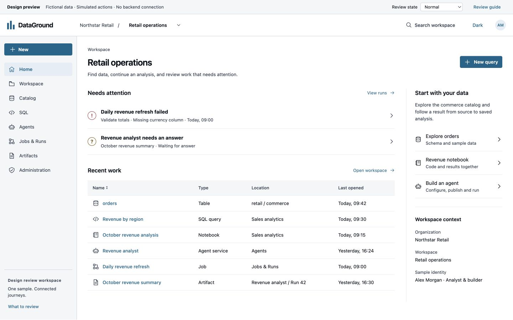
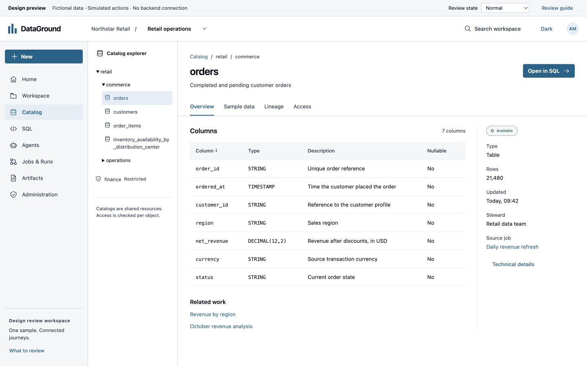
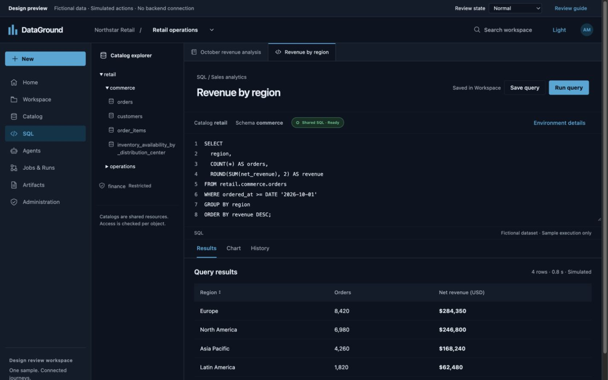
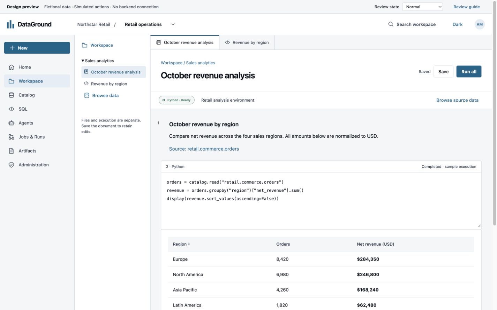
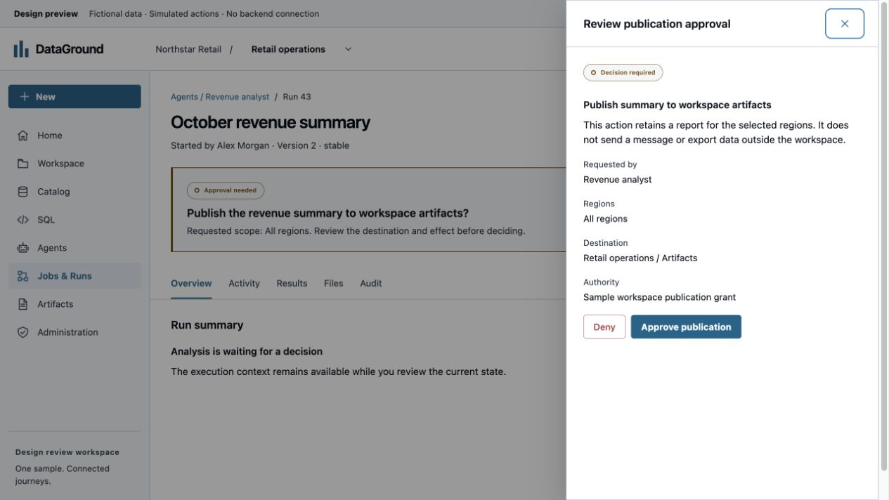
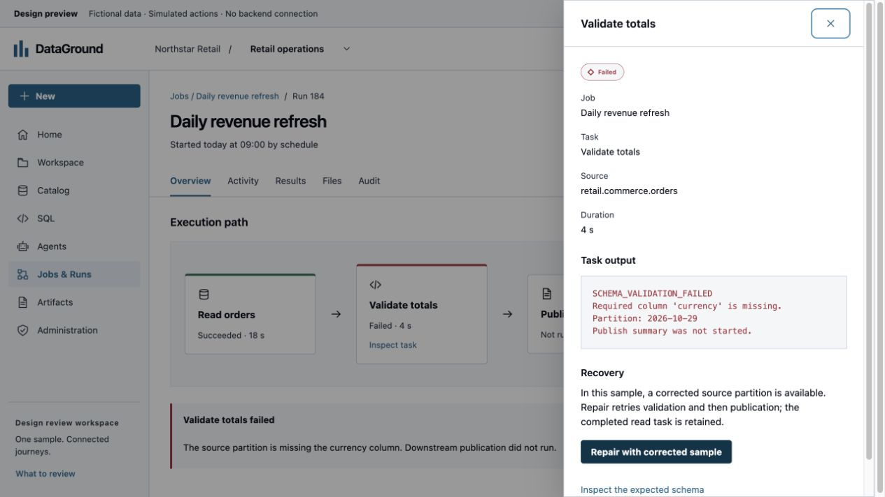
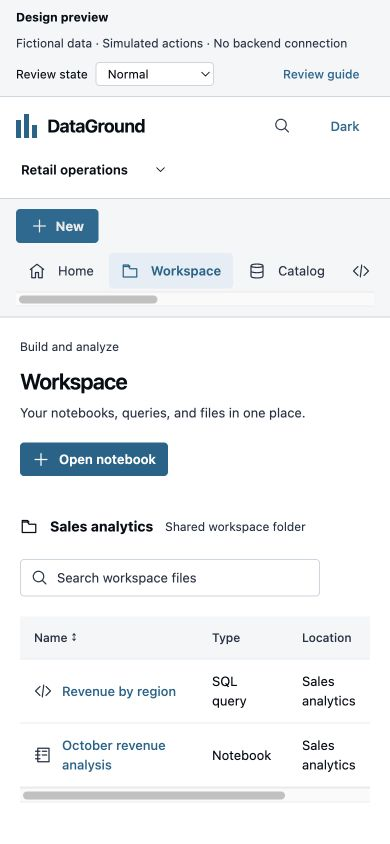

# Prototype review evidence

These screenshots show the isolated fictional prototype, not the production workbench. They were captured with the built-in Browser. Use `pnpm dev:prototype` and the [journey scripts](README.md#coherent-sample-and-journey-scripts) to inspect the interactions.

## Home: attention and recent work

The left rail provides stable application navigation. The header provides workspace context once. Required decisions and failures precede recent work. The table supports comparison without opening each resource; the right column provides analyst and builder entry points. There are no decorative health counters.

## Catalog: hierarchy and resource views

The catalog hierarchy remains on the left. The selected table has a name, description and direct analysis action. Schema, sample data, lineage and access have separate resource views. Stewardship and update metadata are secondary; neither is presented as execution readiness. The long inventory name wraps within the explorer.

## SQL: coordinated editor and results

Document tabs retain nearby notebook context. Catalog selection and environment readiness are separate from query text. Results appear below the editor, with chart and history as alternate views. Save is independent of execution. The dark theme uses the existing semantic token system.

## Notebook: source and output

The file browser, code and output remain in one work surface. Source data opens in a drawer. Saving a notebook does not establish kernel readiness or execution success.

## Approval: effect and destination

The required decision remains visible in the run behind the drawer. The inspector names the action, regions, destination and authority before its approve/deny controls. It does not replace the run with a generic chat screen. Escape closes the inspector and restores focus to its trigger.

## Failure: task context and recovery

The graph shows the fixture's declared task dependencies. The failed task exposes the missing-column error, affected partition and available corrected-source repair. The completed read and blocked downstream task remain visible. This is a local sample transition, not evidence of a real job recovery implementation.

## Narrow layout

The primary navigation becomes a horizontal strip. Actions wrap. The resource table remains a keyboard-focusable horizontal scroll region. No separate mobile navigation model is introduced.

## Checks and limits

Manual Browser checks covered the dataset → sample → SQL → results/chart → save journey, notebook source inspection and output, version publication → route assignment → question → approval → output, failed task inspection and repair, output origin links, and administration access/readiness inspection. Search with no matches, table sorting, Escape/focus return, keyboard table access, light/dark presentation, long catalog names, desktop and narrow layouts were inspected. Browser history was checked on resource views. The review state controls expose additional sample failure conditions.

The prototype's automated tests cover distinct publication/routing boundaries, uncertain publication, expired answers, answer-before-approval, cancellation before observed stop, unsupported code, ignored late completion, independent draft retention, reset and deep-link parsing. Separate tests ensure the preview CSP blocks connections/forms and the production build does not include the preview. Type checking and the preview bundle build are part of `pnpm verify:prototype`.

These checks do not establish real API behavior, authorization, runtime readiness, storage, retention or release acceptance. Screen-reader speech output, complete zoom testing, full accessibility conformance, conflicting multi-user writes and real reconnect/replay behavior need production journey verification. The prototype's reducer tests represent selected failure states; they are not substitutes for backend resilience tests. Representative-user task testing is still required. Production migration remains blocked on the user's design review, regardless of CI results.
